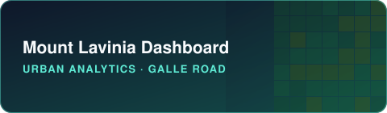
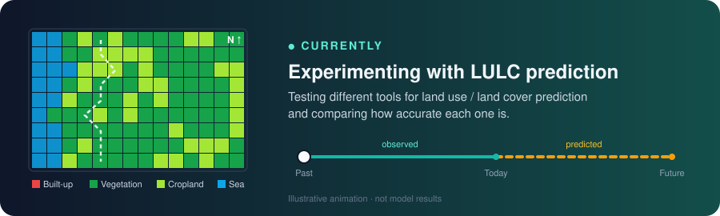

**I build spatial tools that turn GIS analysis into something a planner can use.**

<!-- TODO (optional): pixel-art banner, e.g. assets/pixel-colombo.gif — an 8-bit Galle Road / coastline loop.
     Must be your own artwork (Aseprite/Piskel) or properly licensed; keep it under ~1 MB. -->

---

## 🗂️ Projects

<table>
<tr>
<td width="50%" valign="top">

Decision-support app for five Grama Niladhari divisions on the Galle Road corridor: network centrality, density, walk access, land-cover change and modelled thermal comfort.

    

 

</td>
<td width="50%" valign="top">

Offline-first, belt-based path from beginner to Python and GIS programming, with a real interpreter in the page. White Belt is built; later belts are mapped.

   

 

</td>
</tr>
<tr>
<td width="50%" valign="top">

Directory of verified datasets, dashboards and relief links after Cyclone Ditwah. It indexes official and community sources; it does not generate data.

 

 

</td>
<td width="50%" valign="top">

Third-semester modules, concepts, tools and a downloadable PDF for BSc (Hons) Urban Informatics & Planning students, based on the student handbook.

  

 

</td>
</tr>
</table>

---

## 🛠️ Tools I use

<!-- Only tools that appear in my repositories; each links to its official docs -->

 

---

## 🧭 How I work

  

## 📌 Currently

  

---

## 🐍 Contributions

<!-- Generated by .github/workflows/snake.yml from my real contribution graph, published to the `output` branch -->
<picture>
  <source media="(prefers-color-scheme: dark)" srcset="https://raw.githubusercontent.com/BronXTJ/BronXTJ/output/github-snake-dark.svg"/>
  
</picture>

<!-- Optional, third-party and sometimes rate-limited. Uncomment if you want it.

  

-->

<!-- Footer wave -->

